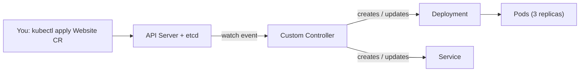

# Kubernetes Notes: Day 9: CRD, Custom Resource and Custom Controller

## 1. The Big Idea (Easy Language)

Kubernetes comes with built-in object types: **Pod, Deployment, Service, ConfigMap**, and so on. But what if your company needs something Kubernetes does not have, like a **Database**, a **Certificate** or a **Backup**?

Kubernetes lets you **add your own object types** and **teach it how to manage them**. This is done with three pieces:

| Piece | Easy meaning | Restaurant analogy |
|---|---|---|
| **CRD** (Custom Resource Definition) | Defines a **new type** of object | The **menu** with a new dish added |
| **CR** (Custom Resource) | An **actual object** of that new type | An **order** for that dish |
| **Custom Controller** | A program that **watches the objects and does the work** | The **chef** who cooks the order |

```
CRD  = "A new kind called Website exists"            (the blueprint)
CR   = "I want a Website named my-blog with 3 copies" (the request)
Controller = "I see your request, I will create the Deployment and Service for it"
```

---

## 2. Custom Resource Definition (CRD)

A **CRD** tells the Kubernetes API server: "**There is a new object type called X, and here is its shape.**"

After you apply a CRD, Kubernetes understands the new kind, and you can use `kubectl get`, `apply` and `delete` on it just like a Pod.

**What a CRD defines:** the name and group of the new kind, its version, whether it is namespaced or cluster-wide, and a **schema** (which fields are allowed and their types).

```yaml
apiVersion: apiextensions.k8s.io/v1
kind: CustomResourceDefinition
metadata:
  name: websites.example.com        # <plural>.<group>
spec:
  group: example.com
  scope: Namespaced
  names:
    kind: Website                   # the new kind
    plural: websites                # used in kubectl get websites
    singular: website
    shortNames: ["ws"]
  versions:
    - name: v1
      served: true
      storage: true
      schema:
        openAPIV3Schema:
          type: object
          properties:
            spec:
              type: object
              properties:
                image:
                  type: string
                replicas:
                  type: integer
```

| Field | Meaning |
|---|---|
| `metadata.name` | Must be `<plural>.<group>` |
| `group` | API group of the new kind (e.g. `example.com`) |
| `scope` | `Namespaced` or `Cluster` |
| `names.kind` | The new kind name (used in YAML) |
| `names.plural` | Name used in `kubectl get <plural>` |
| `versions` | API versions, with the **schema** that validates the objects |

```bash
kubectl apply -f crd.yaml
kubectl get crd
```

> A CRD alone only **stores data**. It does not create any Pods.

---

## 3. Custom Resource (CR)

A **CR** is an **object created from a CRD**, just like a Pod is an object of the built-in `Pod` kind.

```yaml
apiVersion: example.com/v1          # group/version from the CRD
kind: Website                       # the kind defined in the CRD
metadata:
  name: my-blog
spec:
  image: nginx:1.25
  replicas: 3
```

```bash
kubectl apply -f website.yaml
kubectl get websites
kubectl describe website my-blog
```

It is stored in **etcd** like any other object. But on its own it is **only a record of what you want**. Nothing happens until a controller acts on it.

---

## 4. Custom Controller

A **custom controller** is a program (usually running as a Pod in the cluster) that:

1. **Watches** the custom resources through the API server
2. **Compares** the **desired state** (the CR) with the **actual state** (what exists)
3. **Acts** to make them match (creates, updates or deletes real resources)
4. **Repeats** forever. This is called the **reconcile loop**.

This is the same pattern the built-in controllers use. For example, the Deployment controller keeps the right number of Pods running.

### 4.1 Diagram

```
   You                      API Server / etcd              Custom Controller
    |                              |                              |
    | 1. kubectl apply Website CR  |                              |
    |----------------------------->| stores the CR                |
    |                              |   2. event: "new Website"    |
    |                              |----------------------------->|
    |                              |                              | 3. read CR:
    |                              |                              |    image=nginx, replicas=3
    |                              |   4. create Deployment       |
    |                              |<-----------------------------|
    |                              |   5. create Service          |
    |                              |<-----------------------------|
    |                              |                              | 6. keep watching,
    |                              |                              |    fix any drift
```



**Result:** you write 5 lines of YAML (`kind: Website`), and the controller builds the Deployment, Service and everything else behind the scenes.

### 4.2 How Controllers Are Written

- **Languages:** Go is most common (using `client-go`), also Python (Kopf), Java and others
- **Frameworks:** **Kubebuilder**, **Operator SDK**

### 4.3 Operator = CRD + Controller

An **Operator** is the name for **a CRD plus a custom controller** that together **automate the work a human operator would do** (install, upgrade, back up, heal) for a complex application.

---

## 5. Industry Examples

### 5.1 Example 1: cert-manager (TLS Certificates)

Problem: managing HTTPS certificates manually is slow and error-prone.

| Piece | In cert-manager |
|---|---|
| **CRD** | `Certificate`, `Issuer`, `ClusterIssuer` |
| **CR** | "I want a certificate for `shop.example.com`" |
| **Controller** | Talks to Let's Encrypt, gets the certificate, saves it as a Secret, **renews it automatically** |

```yaml
apiVersion: cert-manager.io/v1
kind: Certificate
metadata:
  name: shop-cert
spec:
  secretName: shop-tls
  dnsNames:
    - shop.example.com
  issuerRef:
    name: letsencrypt
    kind: ClusterIssuer
```

This connects to Day 7: the `shop-tls` Secret is what the Ingress uses for HTTPS.

### 5.2 More Real-World Operators

| Tool | CRD / CR example | What the controller does |
|---|---|---|
| **Prometheus Operator** | `Prometheus`, `ServiceMonitor` | Sets up Prometheus and configures what to monitor |
| **Argo CD** | `Application` | Syncs the cluster with a Git repository (GitOps) |
| **Strimzi** | `Kafka`, `KafkaTopic` | Runs and manages Kafka clusters |
| **Postgres operators** (CloudNativePG, Zalando) | `Cluster` / `postgresql` | Creates databases, handles failover and backups |
| **Istio** | `VirtualService`, `Gateway` | Configures service mesh traffic |
| **Crossplane** | `Database`, `Bucket` | Creates cloud resources (AWS, Azure, GCP) from Kubernetes |
| **Gateway API** | `Gateway`, `HTTPRoute` | Routes external traffic (the successor to Ingress) |

### 5.3 Example in Plain Words: A Database Operator

Without an operator, running a production database means a person must: set up replicas, configure backups, handle failover, and run upgrades.

With an operator, you write:

```yaml
kind: PostgresCluster
spec:
  instances: 3
  backup: daily
```

and the controller creates the Pods, storage and replication, takes backups, **promotes a replica if the primary fails**, and handles upgrades.

---

## 6. Uses of CRDs, CRs and Controllers

| Use | Benefit |
|---|---|
| **Extend Kubernetes** without changing its source code | Add any new object type |
| **Automate complex apps** (databases, Kafka, monitoring) | Install, scale, backup, upgrade and heal automatically (Operators) |
| **Simplify for developers** | One short YAML instead of many Deployments, Services and ConfigMaps |
| **Platform engineering** | Platform team offers `kind: Database` or `kind: Website`, developers just request them |
| **GitOps and declarative workflows** | Everything is YAML in Git, managed with `kubectl` and RBAC |
| **Manage external resources** | Create cloud databases, buckets or DNS records from Kubernetes (Crossplane) |
| **Reuse Kubernetes features** | Get API, RBAC, validation, `kubectl` and watch support for free |
| **Self-healing and consistency** | The reconcile loop keeps the real state matching the desired state |

### When NOT to Use

- A normal Deployment and Service already do the job
- You only need to run a one-off task (use a Job)
- You do not have the capacity to build and maintain a controller (prefer a ready-made operator)

---

## 7. Quick Commands

```bash
kubectl get crd                              # list all CRDs
kubectl describe crd websites.example.com
kubectl api-resources | grep example.com     # see the new kind
kubectl get websites                         # list custom resources
kubectl delete -f website.yaml
kubectl delete crd websites.example.com      # also DELETES all its custom resources!
```

---

## Quick Revision

- **CRD** = defines a new object type (the blueprint). **CR** = an object of that type (the request). **Controller** = watches CRs and does the work (the chef).
- A CR alone does nothing. The **controller's reconcile loop** (watch, compare, act, repeat) makes it real.
- **Operator** = CRD + custom controller that automates running a complex app.
- **Industry examples:** cert-manager, Prometheus Operator, Argo CD, Strimzi, Postgres operators, Istio, Crossplane.
- **Uses:** extend Kubernetes, automate complex apps, simplify YAML for developers, platform engineering, GitOps.
- Deleting a CRD **deletes all its custom resources**.
