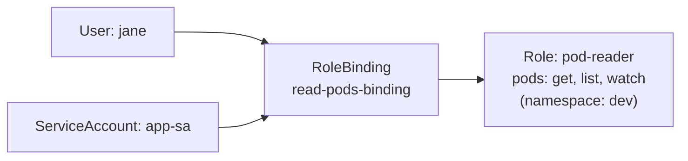

# Kubernetes Notes: Day 8: RBAC

## 1. What is RBAC?

**RBAC (Role-Based Access Control)** controls **who can do what** in a Kubernetes cluster. Permissions are given through **roles**, and roles are given to **users or service accounts**.

**Why we need it:** without access control, anyone with cluster access could delete Pods, read Secrets or change anything. RBAC follows the **principle of least privilege**: give only the access that is needed.

Every request to the API server goes through three steps:

```
Request (kubectl / Pod)
        |
        v
 1. Authentication   -> Who are you?          (user or service account)
 2. Authorization    -> Are you allowed?      (RBAC checks Roles)
 3. Admission        -> Is the request valid? (policies)
        |
        v
   Action allowed or denied
```

**RBAC answers three questions:**

| Question | RBAC object |
|---|---|
| **Who?** | Subject: User, Group or ServiceAccount |
| **What can they do?** | Role (verbs on resources) |
| **Connecting the two** | RoleBinding |

---

## 2. Two Types of Accounts

| | **User Account** | **Service Account** |
|---|---|---|
| **For** | Humans (admins, developers) | Applications / Pods / automation |
| **Managed by** | **Outside Kubernetes** (certificates, OIDC, AWS IAM, Azure AD) | **Kubernetes** (it is an API object) |
| **Kubernetes object?** | **No**, there is no `User` object | **Yes**, `kind: ServiceAccount` |
| **Scope** | Cluster-wide identity | **Namespaced** |
| **Created with** | Certificate, identity provider | `kubectl create serviceaccount` |
| **Example** | `jane`, `admin` | `system:serviceaccount:dev:app-sa` |
| **Credential** | Client certificate, token | Token mounted into the Pod |

```
 Human (jane) ---- kubectl ----+
                               +----> API Server ----> RBAC check
 Pod (uses app-sa) -- API call-+
```

### Service Accounts in Detail

- Every namespace has a **`default`** service account, used by Pods that do not specify one.
- A Pod gets the identity of its service account, so the **app inside the Pod** can call the Kubernetes API (for example, a monitoring app that lists Pods).
- Best practice: create a **dedicated service account per app** with minimal permissions, instead of using `default`.

```yaml
apiVersion: v1
kind: ServiceAccount
metadata:
  name: app-sa
  namespace: dev
```

Use it in a Pod:

```yaml
spec:
  serviceAccountName: app-sa
  containers:
    - name: app
      image: nginx:1.25
```

---

## 3. Role and RoleBinding

### 3.1 Role

A **Role** is a **set of permissions** inside **one namespace**. It says which **verbs** are allowed on which **resources**.

- Permissions are **additive only**. There is no "deny" rule. If nothing allows it, it is denied.

```yaml
apiVersion: rbac.authorization.k8s.io/v1
kind: Role
metadata:
  name: pod-reader
  namespace: dev
rules:
  - apiGroups: [""]              # "" = core group (Pods, Services, Secrets...)
    resources: ["pods"]
    verbs: ["get", "list", "watch"]
```

| Field | Meaning |
|---|---|
| `kind: Role` | Namespaced permission set |
| `namespace: dev` | The Role only applies in `dev` |
| `apiGroups` | API group of the resource (`""` core, `apps` for Deployments) |
| `resources` | What objects (`pods`, `services`, `deployments`, `secrets`) |
| `verbs` | Allowed actions |

**Common verbs:** `get`, `list`, `watch` (read), `create`, `update`, `patch`, `delete` (write).

### 3.2 RoleBinding

A **RoleBinding** **gives a Role to a subject** (user, group or service account) within a namespace. A Role alone does nothing until it is bound.

```yaml
apiVersion: rbac.authorization.k8s.io/v1
kind: RoleBinding
metadata:
  name: read-pods-binding
  namespace: dev
subjects:
  - kind: User                    # or ServiceAccount, Group
    name: jane
    apiGroup: rbac.authorization.k8s.io
  - kind: ServiceAccount
    name: app-sa
    namespace: dev
roleRef:
  kind: Role
  name: pod-reader                # must match the Role name
  apiGroup: rbac.authorization.k8s.io
```

| Field | Meaning |
|---|---|
| `subjects` | **Who** gets the permissions (User, Group, ServiceAccount) |
| `roleRef` | **Which Role** to give. Must match the Role's name. **Cannot be changed** after creation |

### 3.3 Diagram: How It Fits Together

```
   WHO (Subject)            CONNECTOR               WHAT (Permissions)
+------------------+     +----------------+     +---------------------------+
| User: jane       |     |                |     | Role: pod-reader          |
|                  | --> |  RoleBinding   | --> |   resources: pods         |
| ServiceAccount:  |     | read-pods-     |     |   verbs: get, list, watch |
|   app-sa         |     | binding        |     |   namespace: dev          |
+------------------+     +----------------+     +---------------------------+
```



**Result:** `jane` and `app-sa` can **view Pods in `dev`** only. They cannot delete Pods, view Secrets, or touch other namespaces.

### 3.4 ClusterRole and ClusterRoleBinding

| | Role / RoleBinding | ClusterRole / ClusterRoleBinding |
|---|---|---|
| **Scope** | One namespace | **Whole cluster** |
| **Use for** | Namespace-level access | Cluster-wide resources (Nodes, PersistentVolumes, Namespaces) or access across all namespaces |
| **Example** | Read Pods in `dev` | Read Nodes, or admin on everything |

```
Role  + RoleBinding         = permissions in ONE namespace
ClusterRole + ClusterRoleBinding = permissions in ALL namespaces
ClusterRole + RoleBinding   = reuse a ClusterRole, limited to ONE namespace
```

Built-in ClusterRoles: `cluster-admin` (everything), `admin`, `edit`, `view`.

```bash
kubectl create clusterrolebinding admin-binding --clusterrole=cluster-admin --user=jane
```

---


## Best Practices

- Give the **least privilege** needed.
- Use **dedicated service accounts** per app, not `default`.
- Prefer **Roles** (namespaced) over ClusterRoles where possible.
- Avoid wildcards (`*`) and avoid giving `cluster-admin`.
- Be careful with `secrets` access and with `create` on Pods.
- Review bindings regularly.

---

## Quick Revision

- **RBAC** = who can do what. Flow: Authentication, then Authorization (RBAC), then Admission.
- **Two account types:** **User** (human, managed outside Kubernetes) and **ServiceAccount** (for Pods, a Kubernetes object, namespaced).
- **Role** = permissions in one namespace (verbs on resources, allow-only). **RoleBinding** = gives the Role to a user, group or service account.
- **ClusterRole / ClusterRoleBinding** = same idea but cluster-wide.
- Test with `kubectl auth can-i <verb> <resource> --as=<user>`.
